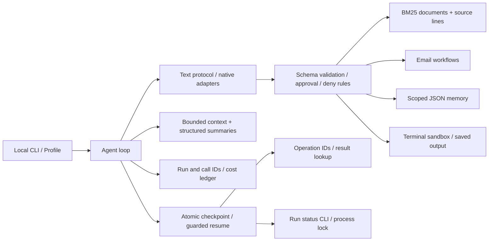

# Cardinal Agent

一个可嵌入 Python 应用的本地 Agent Harness，负责模型与工具之间的执行循环、参数校验、审批、上下文管理、持久记忆和故障恢复。员工个人助手是随项目提供的参考应用，支持文档与邮件检索。

**Explicit tools, durable checkpoints, bounded execution, and inspectable traces.** 模型推理使用配置的外部 API；通用运行时也接受自定义模型 callable，不依赖邮件数据。

项目资料：[文档阅读导航](docs/README.md) · [架构说明](docs/architecture.md) · [评测记录](docs/evaluations/README.md)

## Harness 开发接口

```python
from pathlib import Path
from cardinal_agent.harness import create_session
from cardinal_agent.types import AgentConfig, ToolSpec

# model 接收消息列表，返回包含文本工具协议的字符串。
# 可使用 cardinal_agent.llm.LM，也可接入自己的适配器。
from cardinal_agent.llm import LM

lookup = ToolSpec(
    name="lookup", description="Look up a local item",
    parameters={"type": "object", "properties": {"key": {"type": "string"}},
                "required": ["key"], "additionalProperties": False},
    fn=lambda key: {"owner": "Morgan"}.get(key, "Unknown"),
    read_only=True,
)
config = AgentConfig(checkpoint_path=Path(".cardinal/run.json"), mode="confirm")
session = create_session(LM(), [lookup], config)
print(session.send("Look up owner").text)
# 若进程异常退出，使用相同模型、工具与配置构造 session 后：
# result = session.resume()
```

`create_session()` 只加载显式传入的工具；已有应用入口保留员工助手默认工具。工具函数和模型对象由调用方重新构造，checkpoint 不序列化可执行对象或 API key。checkpoint 包含对话和工具输出，按敏感本地数据管理。

- **断点恢复**：原子保存上下文、执行预算和工具结果；本地进程锁防止同一 checkpoint 并发写入。
- **不确定结果暂停**：工具执行前先记录调用意图。执行中退出时，不自动重试；有结果核对回调的工具先查询回执，其他工具需人工核实后通过 `resume(ToolResult(...))` 提交结果。
- **运行追踪**：运行 ID、工具调用 ID、事件顺序、时间戳及工具耗时，与原有对话、模型 token 和费用记录配合排查。
- **协作取消**：Python 调用方可调用 `session.cancel()`，在下一执行边界停止；不能强制终止正在阻塞的模型请求或任意 Python 工具。

### 原生工具与可恢复工具

除了原有文本协议，提供 `OpenAIChatAdapter` 和 `AnthropicMessagesAdapter`，通过注入 SDK 请求方法接入原生调用，仍复用参数校验、审批和恢复。当前为非流式、每轮一个工具调用；已在 DeepSeek 两种兼容端点上完成 46/46 项真实联调；不代表已测试 OpenAI 或 Claude 模型。示例与限制见 [原生适配器](docs/20-native-tool-adapters.md)。

工具可提供 `execute_with_id(args, operation_id)` 和 `lookup_result(args, operation_id)`。运行时生成并保存操作 ID；恢复时查到确定结果才继续，查询失败或无结果仍暂停。内置 [SQLite 报告示例](cardinal_agent/examples/durable_reports.py) 演示事务写入和相同操作去重。见 [幂等与核对设计](docs/18-operation-reconciliation.md)。

查看运行状态，无需 API key：

```bash
cardinal runs list
cardinal runs show RUN_ID
cardinal runs show RUN_ID --trace
```

默认摘要显示状态、尝试次数、未确认操作和恢复条件；`--trace` 才展开对话与工具输出。活跃状态依据进程锁探测，区分执行、等待批准、失败、中断、结果待核实和完成。见 [状态设计](docs/19-run-status.md)。

恢复不提供任意外部系统的“恰好一次”保证。schema 相同也不能证明工具实现、文档数据或工作目录内容相同。使用相同代码和数据恢复；当前不是分布式任务调度器。详见 [恢复设计与故障验证](docs/16-durable-runtime.md)。

## 下载与运行

GitHub Releases 提供 `code.zip`、Python wheel、`SHA256SUMS` 和记录源码 commit 的 manifest。已发布 `v0.1.1` 本地预览版。上述 Harness 恢复、核对、状态查询和原生适配功能位于当前源码，尚未包含在 v0.1.1 附件中。

需要 Python 3.11+。源代码安装：

```bash
# 下载 code.zip 并解压后，进入 cardinal-agent-0.1.1
uv sync --locked
uv run cardinal --version
uv run cardinal init --demo --provider deepseek --model deepseek-flash
uv run cardinal demo onboarding
```

最后一条是 **不调用 LLM 的真实本地 BM25 检索演示**，不需要 API key。演示资料是虚构的，与实际公司账号无关。

也可以安装 Release 中的 wheel，获得全局可执行的命令：

```bash
uv tool install ./cardinal_agent-0.1.1-py3-none-any.whl
cardinal --help
```

不要直接从 PyPI 安装同名项目；本项目目前通过本仓库 Release 文件分发。没有 uv 时，可在自己的虚拟环境运行 `python -m pip install ./cardinal_agent-0.1.1-py3-none-any.whl`。

配置你自己的 API key（以下是 Bash 示例，不要把真实 key 放进聊天或 Git）：

```bash
export DEEPSEEK_API_KEY='your-key'
cardinal doctor
cardinal chat
# 或单次提问
cardinal ask "Who owns the demo Aurora project? Cite your source."
```

源码使用者将命令前加 `uv run`。OpenRouter 可用 `cardinal configure --provider openrouter --model openai/gpt-6-luna`，并设置 `OPENROUTER_API_KEY`。可用模型受现有 LM 封装支持范围限制，doctor 会在发请求前校验。

## 用自己的资料

创建独立空 profile，再导入资料，避免把演示内容当作实际制度：

```bash
cardinal --home ./work-assistant init --provider deepseek --model deepseek-flash
cardinal --home ./work-assistant import docs ./approved-company-docs
cardinal --home ./work-assistant import emails ./exported-emails.jsonl
cardinal --home ./work-assistant doctor
cardinal --home ./work-assistant chat
```

默认 profile 位于 `$XDG_DATA_HOME/cardinal-agent`，未设置时为 `~/.local/share/cardinal-agent`。配置、资料、记忆、模型缓存、会话和命令工作目录均在 profile 内。不要把自有 profile 放进 Git，或将公司资料交给未获批准的模型服务。

文档暂支持 UTF-8 Markdown，按标题/段落分块，返回原文片段及行号。邮件支持经过校验的 JSONL 导出，格式见 [本地使用指南](docs/local-usage.md)。暂不支持实时邮箱、日历、PDF/OCR 或办公套件连接器。

## 日常使用流程

- **资料问答**：查询制度、组织和项目文档，查看来源 ID/行号；新政策以明确生效日期和替代关系判断。
- **邮件处理**：搜索、原文读取、多跳问答、按 UTC 日期生成日报。
- **个人记忆**：显式记忆及用户明确陈述的自动提取，按项目范围、时间和来源管理；`cardinal memory` 查看，`cardinal memory --forget ID` 删除单条。
- **可追溯会话**：每轮保存完整日志，失败也保存；`cardinal history` 列表，`cardinal history --show ID` 查看。
- **中断恢复**：`cardinal chat --resume ID` 继续尚未结束的 checkpoint；需使用原模型配置和终端启用选项。结果不明的工具会暂停，须通过 Python 接口核实处理。
- **运行诊断**：`cardinal doctor` 不调用模型，检查资料、API 配置、模型、隔离能力和已记录费用。

默认仅只读工具。需要运行命令时显式启用：

```bash
cardinal chat --terminal
```

每条命令均请求批准；无 OS jail 时拒绝启用，只有明确了解风险后才能加 `--allow-unisolated-terminal`。程序白名单和正则不等于完整安全隔离。CLI 目前不支持在同步命令执行过程中实时输入 steering；框架支持 UserIO 注入，终端界面仍是串行交互。

默认费用上限是 **每 profile 累计 $1**，不是每次请求 $1；提高上限用 `cardinal configure --budget 5`，不会清零旧费用。真实费用以服务商账单为准。缓存命中不会新增 API 支出，不能当作代码推理加速。

## 故障恢复验证

新增真实子进程故障测试：在执行前、等待审批、执行中和结果保存后发送 SIGKILL，再启动全新进程恢复。覆盖保留预算、锁释放、人工核实以及事务回执自动核对，检查真实写入数量没有增加。当前源码离线回归 **424 passed，13 live deselected**，其中包含 **6 个真实进程故障场景、24 个原生适配器测试**。详细边界见 [进程故障测试](docs/17-process-faults.md)，[原始指标](docs/evaluations/20261116-062855-harness-resilience/metrics.json)及请求样例已保留。

这些检查不代表断电恢复、分布式事务或任意外部服务的恰好一次保证。原生适配器另有真实 API 联调；确定性检查与真实模型任务准确率分别报告。

## 已测数据与范围

当前版本已补做真实模型验证（DeepSeek deepseek-flash、全新本地缓存）：**原生接口 46/46；live pytest 12/13 通过；模拟用户 19/20**。文本协议为 **16/20，未达到 18/20 阈值**，因此不能声称 live 全通过。分类 59/60、邮件问答 22/25、文档问答 20/20、终端 10/10；失败与费用一并保留。详见 [完整 live 报告](docs/21-live-validation.md)。

以下表格保留历史阶段结果，不能与本轮结果混作同一版本：

| 测试 | 已记录结果 | 范围 |
| --- | --- | --- |
| 模拟用户综合评估 | 18/20（90%） | 公开 20 个任务；Agent/用户/评审均为 deepseek-flash；单次、带既有缓存 |
| 邮件分类 | 59/60（98.3%） | 公开分类样本，历史版本 |
| BM25 | 26,278 封邮件，平均查询约 8.4 ms，17 查询平均 recall@10=100% | 历史本机单次测量 |
| 文档问答 | 20/20，单对话文档输出最多 2880 tokens | 公开文档问题，历史版本 |
| 终端问答 | 10/10 | 包含大输出后续读取，历史版本 |
| 提示注入 | 7/7 回答正确，植入命令零执行 | 公开七场景，实际暴露攻击文本；不代表普遍免疫 |

这些结果来自不同阶段，不是对当前版本的一次统一跑分。后续综合评估也为 18/20，但失败任务有变化；没有生产用户或企业部署证据。详见 [评测基线](docs/15-sim-eval.md)、[已停止优化记录](docs/optimization-review.md) 和 [测试数据目录](docs/evaluations/README.md)。

本地应用入口的可安装性、资料隔离和失败保存会另有发布验证记录，不以算法评测替代产品验证。

## 架构



从零实现 Agent 调用循环及检索，不依赖 Agent 框架。使用统一模型接口和隔离命令执行器，业务工具与本地产品入口分离。模块与数据流见 [架构说明](docs/architecture.md)，历史设计与测试记录保存在 docs。

## 开发与评估

```bash
uv sync --locked
uv run pytest local_tests/test_local_cli.py
# 完整基准邮件档案可用时，解压后运行全套离线测试
uv run python data/download.py
uv run pytest tests local_tests
# 保存离线回归、真实进程故障和原生协议测试的完整记录
uv run python tools/verify_harness.py
# 付费综合评估
uv run python -m cardinal_agent.simulation
```

Release 的 code.zip 不含完整公共邮件档案；另行准备公开基准 `data/emails.jsonl.gz` 后再复现全档案测试，并按 `data/source.json` 校验。安装 wheel 只需应用自有数据或内置虚构 demo，不依赖开发仓库。

## 当前成熟度

适合受控的个人本地试用和技术展示。未达到多人企业生产服务要求：缺少 SSO/RBAC、企业连接器与增量同步、完整数据生命周期/审计、多 profile 并发一致性、分布式恢复和长期运行验证。模型回答可能出错，命令可能有部分副作用；真实公司部署需要单独验收。

[可用性差距与路线](docs/product-readiness.md) · [本地使用](docs/local-usage.md) · [发布流程](docs/releasing.md) · [项目设计与验证](docs/project-case-study.md)

## 许可

使用条款见 [LICENSE](LICENSE)。第三方归属和许可信息见 [NOTICE](NOTICE.md)。虚构演示资料与公开评估数据不能作为真实公司部署、商业用户规模或人工效率提升的证明。
