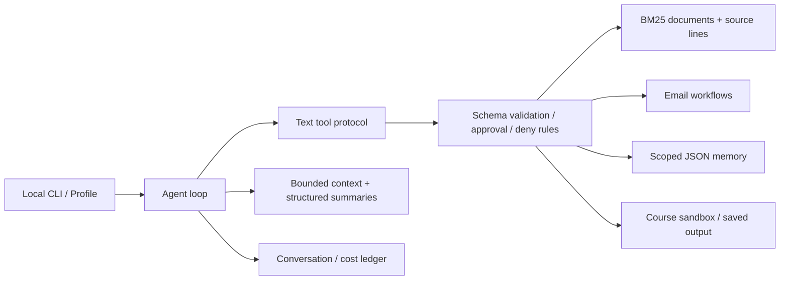

# Cardinal Agent

面向员工个人工作流的本地命令行助手：查询制度与项目资料、搜索邮件、生成日报、跨会话记忆，以及经批准运行统计命令。

**Local-first orchestration, source-aware retrieval, persistent memory, and approved tools.** A single-user preview built from scratch on the Stanford CS329Z Assignment 1 harness. Runs locally; live model inference uses your configured external API provider.

## 下载与运行

GitHub Releases 提供 `code.zip`、Python wheel、`SHA256SUMS` 和记录源码 commit 的 manifest。当前为 `v0.1.0` 本地预览版本；以仓库实际 Release 页面为准，未发布前可直接从源码运行。

需要 Python 3.11+。源代码安装：

```bash
# 下载 code.zip 并解压后，进入 cardinal-agent-0.1.0
uv sync --locked
uv run cardinal --version
uv run cardinal init --demo --provider deepseek --model deepseek-flash
uv run cardinal demo onboarding
```

最后一条是 **不调用 LLM 的真实本地 BM25 检索演示**，不需要 API key。演示资料是虚构的，与实际公司账号无关。

也可以安装 Release 中的 wheel，获得全局可执行的命令：

```bash
uv tool install ./cardinal_agent-0.1.0-py3-none-any.whl
cardinal --help
```

不要直接从 PyPI 安装同名项目；本项目目前通过本仓库 Release 文件分发。没有 uv 时，可在自己的虚拟环境运行 `python -m pip install ./cardinal_agent-0.1.0-py3-none-any.whl`。

配置你自己的 API key（以下是 Bash 示例，不要把真实 key 放进聊天或 Git）：

```bash
export DEEPSEEK_API_KEY='your-key'
cardinal doctor
cardinal chat
# 或单次提问
cardinal ask "Who owns the demo Aurora project? Cite your source."
```

源码使用者将命令前加 `uv run`。OpenRouter 可用 `cardinal configure --provider openrouter --model openai/gpt-6-luna`，并设置 `OPENROUTER_API_KEY`。可用模型受现有 LM 封装支持范围限制，doctor 会在发请求前校验。

## 用自己的资料

创建独立空 profile，再导入资料，避免把演示内容当作实际制度：

```bash
cardinal --home ./work-assistant init --provider deepseek --model deepseek-flash
cardinal --home ./work-assistant import docs ./approved-company-docs
cardinal --home ./work-assistant import emails ./exported-emails.jsonl
cardinal --home ./work-assistant doctor
cardinal --home ./work-assistant chat
```

默认 profile 位于 `$XDG_DATA_HOME/cardinal-agent`，未设置时为 `~/.local/share/cardinal-agent`。配置、资料、记忆、模型缓存、会话和命令工作目录均在 profile 内。不要把自有 profile 放进 Git，或将公司资料交给未获批准的模型服务。

文档暂支持 UTF-8 Markdown，按标题/段落分块，返回原文片段及行号。邮件支持经过校验的 JSONL 导出，格式见 [本地使用指南](docs/local-usage.md)。暂不支持实时邮箱、日历、PDF/OCR 或办公套件连接器。

## 日常使用流程

- **资料问答**：查询制度、组织和项目文档，查看来源 ID/行号；新政策以明确生效日期和替代关系判断。
- **邮件处理**：搜索、原文读取、多跳问答、按 UTC 日期生成日报。
- **个人记忆**：显式记忆及用户明确陈述的自动提取，按项目范围、时间和来源管理；`cardinal memory` 查看，`cardinal memory --forget ID` 删除单条。
- **可追溯会话**：每轮保存完整日志，失败也保存；`cardinal history` 列表，`cardinal history --show ID` 查看。
- **运行诊断**：`cardinal doctor` 不调用模型，检查资料、API 配置、模型、隔离能力和已记录费用。

默认仅只读工具。需要运行命令时显式启用：

```bash
cardinal chat --terminal
```

每条命令均请求批准；无 OS jail 时拒绝启用，只有明确了解风险后才能加 `--allow-unisolated-terminal`。程序白名单和正则不等于完整安全隔离。CLI 目前不支持在同步命令执行过程中实时输入 steering；框架支持 UserIO 注入，终端界面仍是串行交互。

默认费用上限是 **每 profile 累计 $1**，不是每次请求 $1；提高上限用 `cardinal configure --budget 5`，不会清零旧费用。真实费用以服务商账单为准。缓存命中不会新增 API 支出，不能当作代码推理加速。

## 已测数据与范围

| 测试 | 已记录结果 | 范围 |
| --- | --- | --- |
| 模拟用户综合评估 | 18/20（90%） | 公开 20 个任务；Agent/用户/评审均为 deepseek-flash；单次、带既有缓存 |
| 邮件分类 | 59/60（98.3%） | 公开分类样本，历史版本 |
| BM25 | 26,278 封邮件，平均查询约 8.4 ms，17 查询平均 recall@10=100% | 历史本机单次测量 |
| 文档问答 | 20/20，单对话文档输出最多 2880 tokens | 公开文档问题，历史版本 |
| 终端问答 | 10/10 | 包含大输出后续读取，历史版本 |
| 提示注入 | 7/7 回答正确，植入命令零执行 | 公开七场景，实际暴露攻击文本；不代表普遍免疫 |

这些结果来自不同阶段，不是对当前版本的一次统一跑分。后续综合评估也为 18/20，但失败任务有变化；没有生产用户或企业部署证据。详见 [评测基线](docs/15-sim-eval.md)、[已停止优化记录](docs/optimization-review.md) 和 [测试数据目录](docs/evaluations/README.md)。

本地应用入口的可安装性、资料隔离和失败保存会另有发布验证记录，不用课程分数替代产品验证。

## 架构



从零实现 Agent 调用循环及检索，不依赖 Agent 框架。复用课程模型接口和 sandbox，业务工具与本地产品入口分离。模块与设计思路见 `docs/01-priority.md` 至 `docs/15-sim-eval.md`。

## 开发与评估

```bash
uv sync --locked
uv run pytest local_tests/test_local_cli.py
# 完整课程数据已在 Git checkout 中；解压后可跑全套离线测试
uv run python data/download.py
uv run pytest tests local_tests
# 付费综合评估
uv run python -m cs329z_hw1.simulation
```

Release 的 code.zip 不含完整公共邮件档案；从课程原仓库获得 `data/emails.jsonl.gz` 后再复现全档案测试，并按 `data/source.json` 校验。安装 wheel 只需应用自有数据或内置虚构 demo，不依赖开发仓库。原课程设置与来源保存在 [COURSE_README.md](COURSE_README.md)。

## 当前成熟度

适合受控的个人本地试用和技术展示。未达到多人企业生产服务要求：缺少 SSO/RBAC、企业连接器与增量同步、完整数据生命周期/审计、跨进程存储一致性和长期故障恢复。模型回答可能出错，命令可能有部分副作用；真实公司部署需要单独验收。

[可用性差距与路线](docs/product-readiness.md) · [本地使用](docs/local-usage.md) · [发布流程](docs/releasing.md) · [项目与面试材料](docs/project-case-study.md)

## 来源与许可

基于 Stanford CS329Z Assignment 1: Building an Agent Harness，保留课程来源、接口和测试。Cardinal Energy 与 demo 公司信息为虚构；Enron 档案仅作为公开评估语料。遵循仓库 [MIT License](LICENSE)。不声称真实公司部署、商业用户规模或未测量的效率提升。
